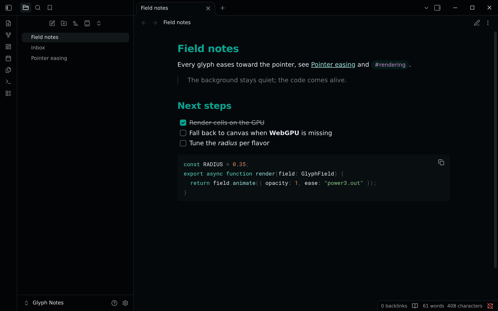
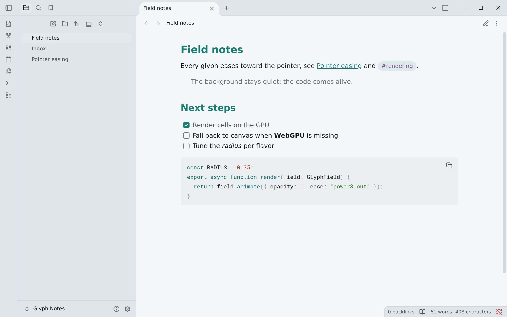

<!-- living-code-readme:1 -->
# 💎 Living Code for Obsidian

**Calm slate. Living color.** Living Code for Obsidian. Repository-owned theme files, installation instructions and four color flavors.

[Installation](#installation) · [Flavors](#flavors) · [Configuration](#configuration) · [All ports](https://github.com/living-code-theme)

## Previews

<table data-lc-flavors>
<tr>
<td width="50%" valign="top">
<strong>Night</strong> Dark · full palette  

</td>
<td width="50%" valign="top">
<strong>Paper</strong> Light · near-white slate  

</td>
</tr>
</table>

Select any preview to view the image at full size.

Frost, Signal are supported; real captures are not available yet.

## Installation

Obsidian's dark mode is **Night** and its light mode is **Paper**; the theme follows *Appearance → Base color scheme*.

1. Open *Settings → Appearance → Themes → Manage*, search for **Living Code** and click **Install and use**.
2. **Without the directory:** copy `manifest.json` and `theme.css` from [the repository root](.) into `<vault>/.obsidian/themes/Living Code/`, then pick **Living Code** under *Appearance → Themes*.

**Frost and Signal** are dark flavors, so they ship as CSS snippets rather than as a Style Settings option, which would need a second plugin: copy `snippets/living-code-frost.css` or `snippets/living-code-signal.css` into `<vault>/.obsidian/snippets/` and enable it under *Appearance → CSS snippets*.

## Flavors

Expand a flavor for its full-size preview and activation instructions.

<strong>Night</strong> · Dark · full palette

Set *Appearance → Base color scheme* to **Dark**. Disable the Frost and Signal snippets to use Living Code Night.

<strong>Frost</strong> · Dark · softer chroma

A real application capture is not available yet.

Set the base color scheme to **Dark**, copy `snippets/living-code-frost.css` to `<vault>/.obsidian/snippets/`, and enable it under *Appearance → CSS snippets*. Disable the other Living Code snippet.

<strong>Paper</strong> · Light · near-white slate

Set *Appearance → Base color scheme* to **Light**. Disable the Frost and Signal snippets to use Living Code Paper.

<strong>Signal</strong> · Dark · teal accent

A real application capture is not available yet.

Set the base color scheme to **Dark**, copy `snippets/living-code-signal.css` to `<vault>/.obsidian/snippets/`, and enable it under *Appearance → CSS snippets*. Disable the other Living Code snippet.

## Configuration

See [Obsidian's documentation](https://obsidian.md) for application settings and reload behavior. The activation instructions above identify each supported flavor; keep your other application configuration.

## Compatibility

The theme manifest retains version 1.0.0 and minAppVersion 1.0.0. Night and Paper follow Obsidian's base color scheme; Frost and Signal are optional dark-mode snippets. The existing Living Code community-theme and release identities are preserved.

## Contributing

Found a problem? [Open an issue](https://github.com/living-code-theme/obsidian/issues/new/choose) with the app version, the flavor and a screenshot. Want Living Code somewhere else? [Request a port](https://github.com/living-code-theme/core/issues/new?template=port-request.yml).

Pull requests are welcome. Keep this README, `port.json` and `images/` in sync, and use real screenshots of the app, never mockups.

🦎 **One chameleon, many habitats.** Part of [Living Code](https://github.com/living-code-theme).

## License

[MIT](LICENSE) © Elliot Luque
